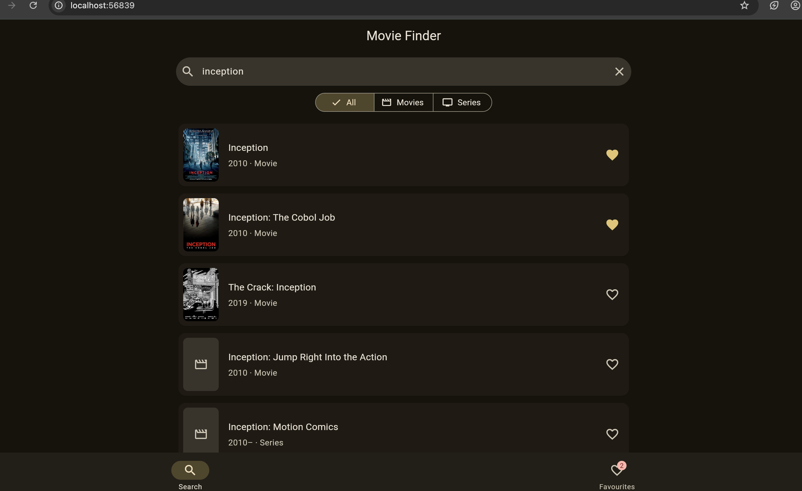
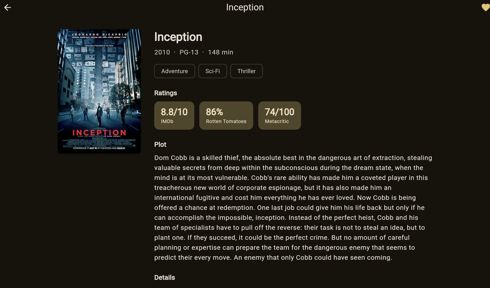
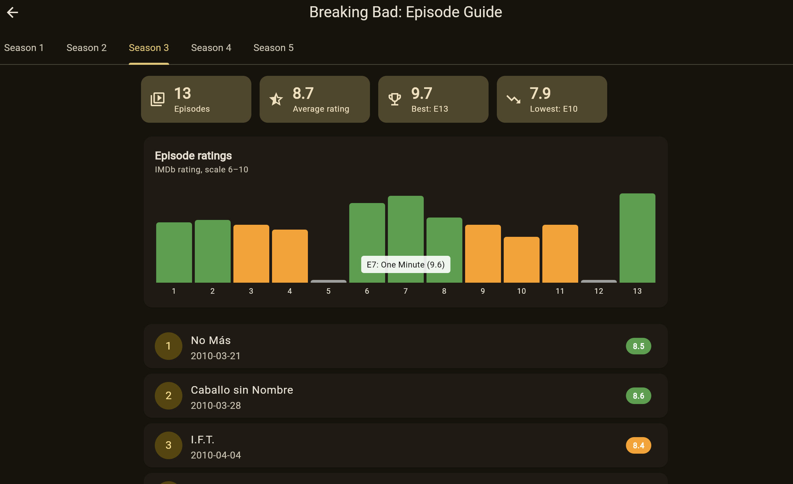

# Movie Finder

A Flutter app for searching films and series using the [Open Movie Database (OMDb) API](https://www.omdbapi.com/).
Built as part of the Shape.tech software developer task.

| Search | Details | Episode guide |
|---|---|---|
|  |  |  |

## Features

- **Search** over a million films and series, with results updating as you type (debounced to avoid
  unnecessary API calls)
- **Filter** by All / Movies / Series
- **Pagination** with a "Load more" button and a "Showing X of Y results" counter
- **Details screen** with poster, genres, ratings (IMDb, Rotten Tomatoes, Metacritic), full plot, director,
  cast, release date, language and awards
- **Episode guide for TV series**: season tabs, every episode with its IMDb rating (colour-coded), the season's
  average, best and lowest episodes, and a **bar chart of episode ratings** so you can see how a season
  develops. Tap any episode for its full plot and details
- **Favourites**: save titles with the heart button; they are stored on the device and stay after the app is
  closed. Swipe left to remove, with **Undo**
- **Smooth poster animation** (Hero) between the list and the details screen
- **Clear loading, empty and error states**, e.g. no internet, invalid API key, no results, daily limit reached,
  each with a friendly message and a "Try again" button
- **Responsive layout**: poster and information side by side on wide screens, stacked on phones
- **Light and dark mode**, following the system setting

## Getting started

1. [Install Flutter](https://docs.flutter.dev/get-started/install)
2. Get a free API key at <https://www.omdbapi.com/apikey.aspx> (remember to click the activation link in the
   email)
3. Run the app:

```bash
flutter pub get
flutter run -d chrome --dart-define=OMDB_API_KEY=your_key_here
```

The API key is passed in at run time with `--dart-define`, so it is **never stored in the code or committed to
Git**.

## Tests

```bash
flutter test
```

- **Unit tests** for the API service using a fake HTTP client: parsing results, building the request, handling
  "not found", API errors and a missing key
- **Unit tests** for the episode guide: parsing seasons and calculating the average, best and lowest episode
- **Unit tests** for favourites: adding, removing, and saving/loading from device storage
- **Widget test** for the main user journey: search → open details → add to favourites

GitHub Actions runs `flutter analyze` and `flutter test` on every push.

## Project structure

```
lib/
├── main.dart                   App setup and theme
├── config.dart                 Reads the API key from --dart-define
├── models/movie.dart           MovieSummary, MovieDetails and Rating (JSON parsing)
├── services/omdb_service.dart  All communication with the OMDb API
├── state/favourites_store.dart Favourites, saved with shared_preferences
├── screens/
│   ├── home_screen.dart        Bottom navigation (Search / Favourites)
│   ├── search_screen.dart      Screen 1: search, filter and results
│   ├── details_screen.dart     Screen 2: full film details
│   ├── favourites_screen.dart  Screen 3: saved favourites
│   └── episode_guide_screen.dart  Screen 4: seasons, episode ratings and chart
└── widgets/                    Reusable UI: poster, movie tile, heart button, messages
```

## Design decisions

- **Separation of concerns.** The UI never calls the API directly; it goes through `OmdbService`. This keeps
  screens simple and means the service can be tested with a fake HTTP client.
- **Dependency injection.** The service and favourites store are passed into the app, so tests can replace
  them without any real network calls.
- **Friendly errors.** OMDb returns technical messages (e.g. `Invalid API key!`) or the text `"N/A"` for
  missing values. These are converted into clear messages or hidden, so the user never sees raw API output.
- **No race conditions.** Each search has an ID, so a slow old response can never overwrite newer results.
- **Honest chart.** The ratings chart starts just below the lowest episode rating so small differences are
  visible, and the caption shows the scale so it isn't misleading. Seasons are kept loaded when switching tabs,
  so each season is only requested once.
- **Minimal dependencies.** Only `http` and `shared_preferences`. State uses Flutter's built-in `ChangeNotifier`,
  and the ratings chart is built from plain Flutter widgets rather than a chart library.

## What I would add next

- Caching responses to save API calls
- Infinite scrolling instead of the "Load more" button
- Sorting results by year
- A Supabase backend to sync favourites across devices
